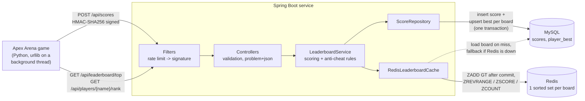

# Apex Arena Leaderboard Service

A backend leaderboard service for **Apex Arena**, my 1v1 monster-battler game (Python + pygame).
The game reports every finished fight to this service, which scores it, stores it and serves
global, per-difficulty and per-monster leaderboards plus each player's rank.

**Stack:** Java 21 · Spring Boot 4.1 · Spring Data JPA · MySQL 8.4 · Flyway · Redis 7.4 ·
JUnit 5 · Mockito · Testcontainers · Docker Compose · GitHub Actions · k6

## Architecture



**Write path.** The game sends the *raw fight result* (monster, difficulty, win/loss, HP left,
fight time, a random `fightId`), never points. The server:

1. rate-limits per IP (token bucket) and verifies the HMAC signature and timestamp,
2. validates the request (Bean Validation) and checks the result is possible in the game,
3. computes the points, inserts the fight into `scores` and upserts the player's best score on
   its three boards (`overall`, `difficulty:<d>`, `monster:<m>`) in `player_best`,
4. after the transaction commits, updates the Redis sorted sets with `ZADD GT`.

**Read path.** Top-N and rank are served from Redis sorted sets (`ZREVRANGE`, `ZSCORE`,
`ZCOUNT`, `ZCARD`). If a board is not cached yet it is loaded from MySQL; if Redis is down the
service answers from MySQL instead.

## API

| Method | Path | Description |
|---|---|---|
| `POST` | `/api/scores` | Submit a fight result (signed). Returns points, best and overall rank. |
| `GET` | `/api/leaderboard/top?n=10` | Overall top N (1-100). |
| `GET` | `/api/leaderboard/top?n=10&difficulty=boss` | Top N for one difficulty (`easy`, `hard`, `boss`). |
| `GET` | `/api/leaderboard/top?n=10&monster=zapret` | Top N for one monster. |
| `GET` | `/api/players/{name}/rank` | Player rank, best and total players (also takes `difficulty` / `monster`). |
| `GET` | `/actuator/health` | Health check. |

Errors use RFC 9457 `application/problem+json`: `400` invalid input, `401` bad or missing
signature, `404` unknown player, `409` replayed `fightId`, `422` impossible result,
`429` rate limited.

Example request body:

```json
{"playerName":"aish","monster":"zapret","difficulty":"boss","mode":"quick",
 "won":true,"hpLeftPercent":60,"fightSeconds":45.0,"fightId":"3f1c...e9"}
```

Headers: `X-Timestamp: <unix seconds>` and
`X-Signature: hex(HMAC-SHA256(secret, "<timestamp>.<raw body>"))`.

## Scoring

| | Easy | Hard | Boss |
|---|---|---|---|
| Base points for a win | 100 | 250 | 500 |

A win scores `base + base × HP-left% + base × 0.5 × (99 − seconds) / 99`, so a flawless, fast
win is worth up to 2.5× base. A loss scores `base / 10`. Each leaderboard ranks a player by
their best single fight. Ties share a rank (1, 1, 3).

## Design decisions

- **Server-side scoring.** The client never sends points, so a modified client cannot just
  claim a high score; it can only send results, which are checked.
- **Anti-cheat layers.** Token-bucket rate limit (cheap, runs first), HMAC-SHA256 request
  signing with a 5-minute timestamp window and constant-time comparison, a unique `fightId`
  per fight (unique index, `409` on replay), and plausibility rules (a winner must have HP left
  and fight at least 3 s). The signing secret ships inside the game client, so it raises the
  bar rather than making cheating impossible; a fully server-authoritative game would be the
  next step.
- **Materialized best scores.** Computing "best per player" with `GROUP BY` over 200k fights
  took about 440 ms per query. The `player_best` table (primary key `(board_key, player_name)`,
  index `(board_key, best_points DESC, player_name)`) is kept current with
  `INSERT ... ON DUPLICATE KEY UPDATE best_points = GREATEST(...)`, which brought top-10 to
  about 0.5 ms.
- **Redis sorted sets.** `ZADD ... GT` only ever raises a score, so writes may arrive out of
  order or twice and the result is still correct. The cache is updated after the database
  commit (`@TransactionalEventListener(AFTER_COMMIT)`), so it never shows a rolled-back score.
  Boards are built in a temporary key and merged with `ZUNIONSTORE ... AGGREGATE MAX`, so a
  half-loaded board is never visible. A per-board lock stops many requests from loading the
  same board at once.
- **Redis is optional.** Short timeouts and a small circuit breaker send traffic to MySQL when
  Redis is unavailable. Writes missed during an outage mark the cache stale, and all boards
  are reloaded when Redis is reachable again.
- **Schema migrations** with Flyway (`db/migration`), with Hibernate set to not touch the
  schema.

## Running it

Requires Docker. Java 21 is only needed to build or test outside Docker.

```bash
docker compose up -d --build        # app on http://localhost:8080, plus MySQL and Redis
curl "http://localhost:8080/api/leaderboard/top?n=10"
```

Without Docker (in-memory H2, no Redis):

```bash
./mvnw spring-boot:run -Dspring-boot.run.profiles=h2
```

Configuration (environment variables): `HMAC_SECRET` (change it for any real deployment),
`CACHE_ENABLED`, `RATE_LIMIT_ENABLED`, `DB_URL`, `DB_USER`, `DB_PASSWORD`, `REDIS_HOST`.

The game side lives in [`game-client/`](game-client/): `leaderboard_client.py` (standard
library only) and the changes made to the game's `main.py`.

## Tests

```bash
./mvnw verify
```

44 tests, all run in CI:

| Kind | What it covers |
|---|---|
| Unit (JUnit 5, Mockito) | Scoring rules (parameterized), token bucket, HMAC signer (checked against a vector produced by the Python client), service logic with mocked repository, cache and event publisher |
| `@WebMvcTest` | Controllers, validation errors, problem+json mapping, signature filter (including a path-parameter bypass attempt) |
| `@DataJpaTest` | Repository SQL on the real Flyway schema (H2 in MySQL mode) |
| `@SpringBootTest` | Whole app on H2: submit, rank, replay (`409`), impossible results (`422`) |
| Testcontainers | Real MySQL 8.4 + Redis 7.4 with the cache on: write-through, `ZADD GT`, loading a 20,000-player board |

The Testcontainers tests are skipped automatically when Docker is not available.

## Load test

Measured with [k6](https://k6.io) ([`loadtest/leaderboard.js`](loadtest/leaderboard.js)) against
the Docker Compose stack, with 200,000 synthetic scores from 20,000 players
([`loadtest/seed.sql`](loadtest/seed.sql)). Everything ran on one laptop (Intel i5-12500H,
16 GB RAM, Docker Desktop on WSL2), with k6 inside the Compose network.

Setup: 50 virtual users, 30 s per run after a 20 s warm-up, **3 runs per scenario, median
shown**, 0 failed requests in every run. Read mix: 50% overall top-10, 25% difficulty top-10,
25% player rank. "Mixed" adds 10% signed score submissions. The only difference between the
two configurations is `CACHE_ENABLED`; MySQL uses the indexed `player_best` table in both.

**Reads only**

| | Requests/s | p50 | p95 | p99 |
|---|---|---|---|---|
| MySQL only | 1,247 | 30.2 ms | 108.8 ms | 163.0 ms |
| With Redis cache | **6,819** | **6.2 ms** | **12.2 ms** | **16.0 ms** |

The cache gives **5.5× the throughput and about 9× lower p95 latency**.

**90% reads / 10% writes**

| | Requests/s | Top-10 p95 | Player rank p95 | Submit p50 / p95 |
|---|---|---|---|---|
| MySQL only | 733 | 137.5 ms | 217.0 ms | 97.6 / 197.5 ms |
| With Redis cache | **1,514** | **12.9 ms** | **18.6 ms** | 258.6 / 422.5 ms |

With writes in the mix, reads served from Redis stay fast while total throughput doubles.
Writes then become the bottleneck: each submission is a transaction with an insert, three
upserts and the rank queries, through the default pool of 10 connections. With the cache on,
about twice as many writes per second compete for that pool, so each one waits longer.
Possible next steps are a bigger connection pool, computing the returned rank from Redis
instead of SQL, and moving the leaderboard upserts off the request path.

Earlier runs of this test found two problems that are fixed in the code above. Loading a
20,000-player board into Redis with one `ZADD` per player timed out, so every read fell back
to MySQL. And `GROUP BY` over all scores made the MySQL path take about 440 ms per top-10
query before the `player_best` table was added.

Reproduce:

```powershell
docker compose up -d --build
Get-Content loadtest/seed.sql | docker compose exec -T mysql mysql -uleaderboard -pleaderboard leaderboard
./loadtest/run.ps1          # writes per-run summaries to loadtest/results/
```
